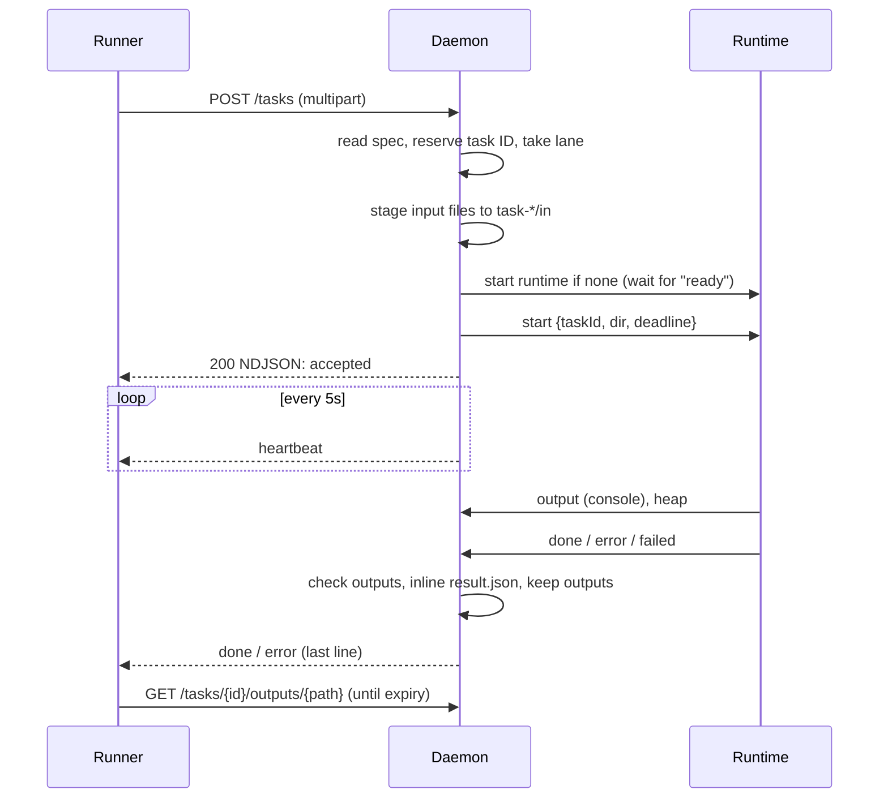
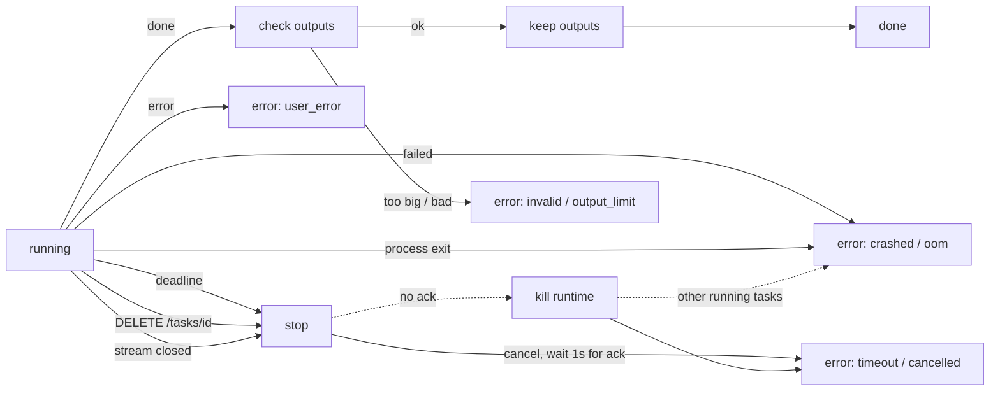
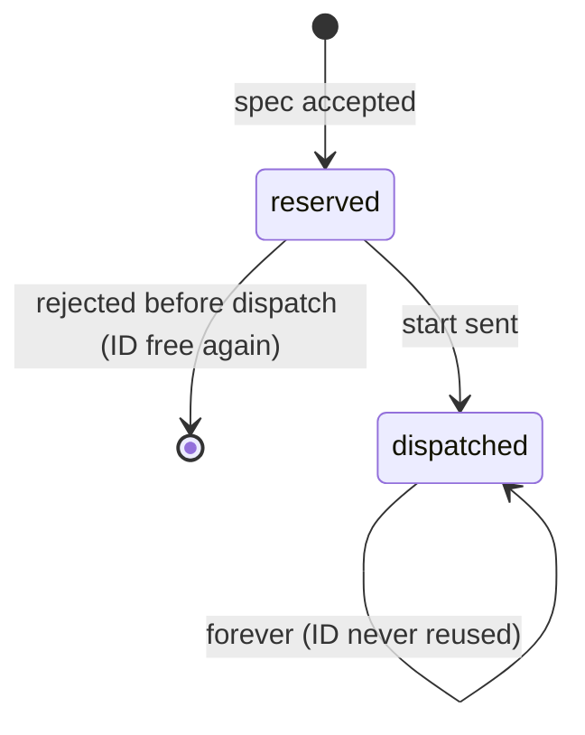
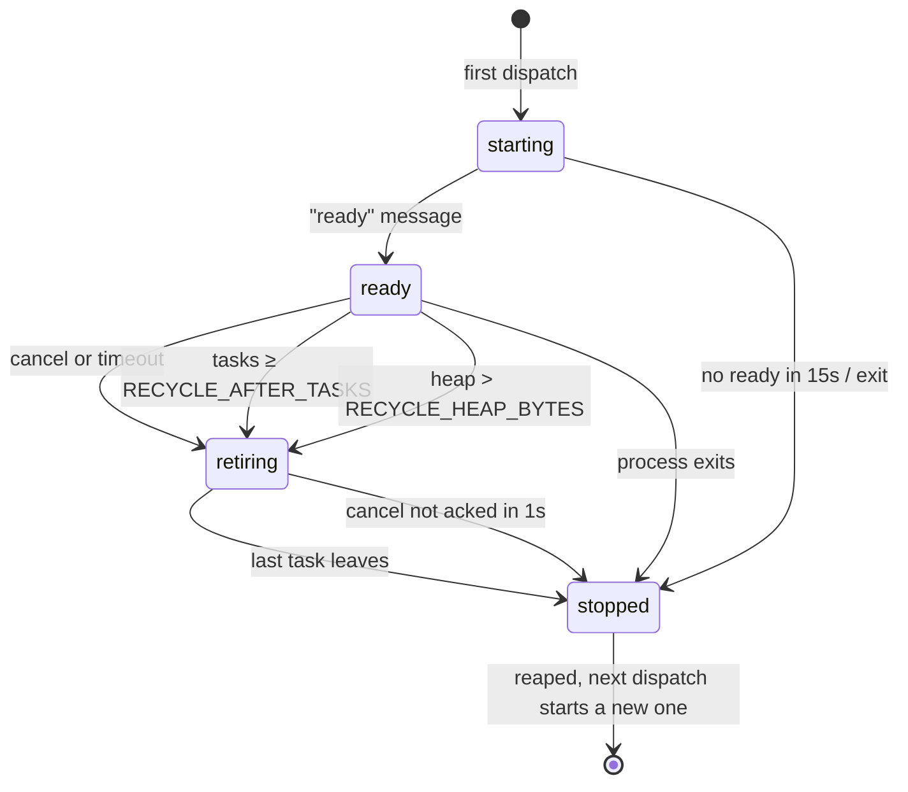
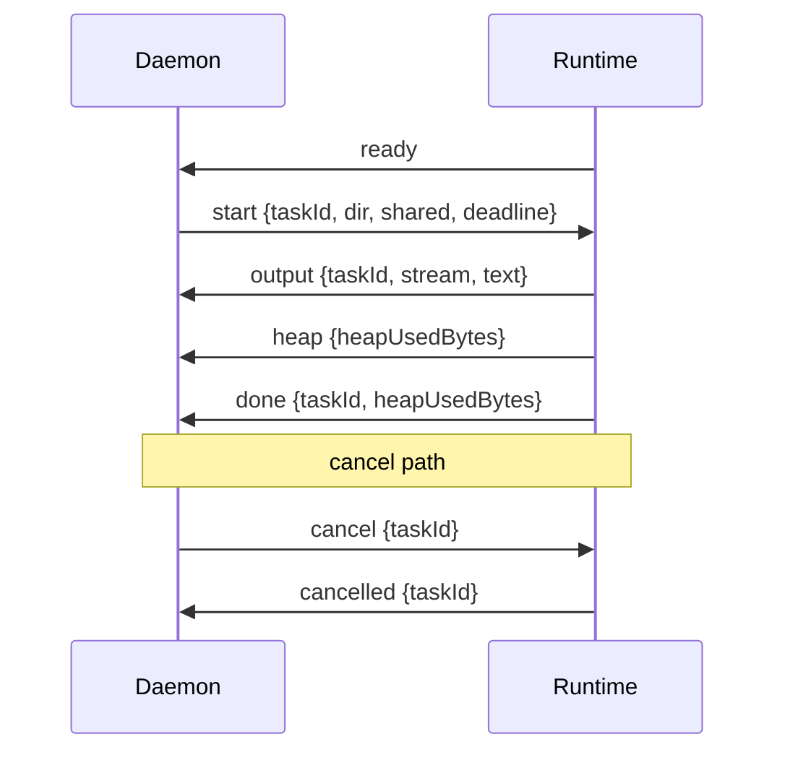

# Code daemon

The code daemon (`cmd/code-daemon`, `internal/codedaemon`) runs inside a code sandbox. It takes tasks from the runner over HTTP and runs them in one shared runtime process (Node.js or Python).

```text
 runner ──HTTP :8081──▶ code-daemon ──NDJSON on FD 3──▶ runtime process
                            │                              │
                            └──── /work/task-*/in, out ◀───┘
```

Settings: [configuration.md](configuration.md#code-daemon). Routes: [API.md](API.md#code-sandboxes).

- [1. Task lifecycle](#1-task-lifecycle)
- [2. Task input over HTTP](#2-task-input-over-http)
- [3. Daemon ↔ runtime protocol](#3-daemon--runtime-protocol)

## 1. Task lifecycle

### Request flow



### Stages and rejections

| Stage | Check | On failure |
| --- | --- | --- |
| Source guard | Peer is not loopback or a sandbox address | `403` |
| Spec | First part is `spec`, ≤ 64 KiB, valid | `400` |
| Task ID | Not reserved or used before | `409 duplicate_task` |
| Lane | Free lane (`CODE_DAEMON_MAX_CONCURRENCY`) | `429 sandbox_full` |
| Staging | Input files within limits | `413 input_limit` / `400 invalid` |
| Runtime | Runtime ready within 15 s | `503 runtime_unavailable` |
| Dispatch | `start` message written within 1 s | NDJSON `error` `crashed` |

Rejections before `accepted` are plain JSON with an HTTP error status. After `accepted`, the status is `200` and the outcome is the last NDJSON line. Rejected uploads are not read to the end; HTTP/1 connections close.

A lane is held from admission until the terminal event is written.

### Execution end



Timeout: `spec.timeoutMs` can only shorten `CODE_DAEMON_DEFAULT_TASK_TIMEOUT`. `CODE_DAEMON_MAX_TASK_TIMEOUT` only caps the configured default.

### Terminal events

| `type` | `code` | Meaning |
| --- | --- | --- |
| `done` | — | Success. Has `result`, `outputs`, `console`, `outputExpiresAt`. `console` holds only `output` messages from the runtime, not raw process stdout/stderr. |
| `error` | `user_error` | User code threw. `userError` has runtime details. |
| `error` | `crashed` | Runtime failed or exited. |
| `error` | `oom` | Runtime ran out of memory (best effort). |
| `error` | `timeout` | Deadline passed. |
| `error` | `cancelled` | `DELETE` or stream closed. |
| `error` | `invalid` | Bad output files or `result.json`. |
| `error` | `output_limit` | No room to keep outputs. |

A broken stream has no known outcome. The daemon does not replay a task.

### Task ID states



`DELETE /tasks/{id}`:

| Task state | Result |
| --- | --- |
| Running | `202`, cancel requested |
| Finished | `204`, outputs removed |
| Uploading or unknown | `404` |

### Outputs

- `result.json` ≤ `inlineResultMaxBytes` (max 1 MiB) is inlined into `result`. Invalid JSON → `error invalid`.
- Missing or larger `result.json` → `result` is `null`.
- `in/` is removed. `out/` is kept for `CODE_DAEMON_OUTPUT_TTL` (default 5 min).
- Kept outputs: max 256 tasks, `CODE_DAEMON_MAX_RETAINED_OUTPUT_BYTES` total. Unexpired outputs are never evicted.

### Runtime process lifecycle

One runtime serves all tasks. It starts on the first task.



- `retiring`: running tasks continue, new tasks do not join.
- Stop = `SIGKILL` to the whole process group. Running tasks fail with `crashed` or `oom`. The task being cancelled or timed out keeps `cancelled` or `timeout`.
- If a runtime dies before `ready`, dispatches return `503` for 1 s.

## 2. Task input over HTTP

`POST /tasks`, `Content-Type: multipart/form-data`. Part order matters.

```text
┌─────────────────────────────────────────┐
│ part 1: name="spec"  JSON               │  required, first
├─────────────────────────────────────────┤
│ part 2: name="input"                    │  task.json, the task itself
│         filename="task.json"            │
├─────────────────────────────────────────┤
│ part 3: name="input" filename="a.csv"   │  0..N more files
│ part 4: name="input" filename="d/b.txt" │
│ ...                                     │
└─────────────────────────────────────────┘
```

```sh
curl -N http://sandbox:8081/tasks \
  -F 'spec={"taskId":"t1","timeoutMs":30000};type=application/json' \
  -F 'input=@task.json;filename=task.json' \
  -F 'input=@b.txt;filename=data/b.txt'
```

### `spec`

| Field | Type | Required | Rule |
| --- | --- | --- | --- |
| `taskId` | string | yes | `^[a-zA-Z0-9_-]{1,128}$`, unique per daemon |
| `timeoutMs` | int | no | ≥ 0. `0` or above the default uses the default. |
| `inlineResultMaxBytes` | int | no | `≤ 0` or > 1 MiB uses 1 MiB |

The spec is read before any file. So `409` and `429` cost no upload.

### `input` parts

| Rule | Value |
| --- | --- |
| Part name | `input` |
| `filename` | Relative path. Folders are kept. Max 1024 bytes. No `..`, `\`, NUL, leading `/`. |
| Same path twice | `400` |
| File count | `CODE_DAEMON_MAX_FILES` (default 256) |
| Total bytes | `CODE_DAEMON_MAX_INPUT_BYTES` (default 64 MiB) |
| Whole upload | 2 min |

### `task.json`

Send `task.json` as an `input` part on every task. The runtime reads it from `in/task.json`. It holds the task input and any runtime data the task needs. The daemon stages it like any other input file and does not check its content.

### Task directory

```text
$CODE_DAEMON_WORK_DIR/task-XXXX/     (0700, per task)
├── in/          input files, as uploaded (0600)
│   └── task.json     task input and runtime data
└── out/         runtime writes here
    ├── bin/
    └── result.json   optional, inlined into "result"
```

### Response stream

`Content-Type: application/x-ndjson`, one JSON object per line:

```json
{"type":"accepted","taskId":"t1"}
{"type":"heartbeat","taskId":"t1"}
{"type":"done","taskId":"t1","result":{"ok":true},"outputs":[{"path":"result.json","size":11}],"console":[{"stream":"stdout","text":"hi"}],"outputExpiresAt":"2026-11-18T10:05:00Z"}
```

## 3. Daemon ↔ runtime protocol

### Process setup

| Item | Value |
| --- | --- |
| Command | `command` argv from `CODE_DAEMON_RUNTIMES_FILE`, entry `CODE_DAEMON_RUNTIME` |
| Working dir | `CODE_DAEMON_WORK_DIR` |
| Env | `PATH`, `HOME`, `NODE_ENV=production` only |
| Process group | Own group, so kill reaches all children |
| Control channel | Unix stream socket on **FD 3** |
| stdout / stderr | Not protocol. Sampled into the daemon log (16 writes × 1 KiB). stderr is scanned for `heap out of memory`. |

### Framing

- NDJSON: one JSON object per line, both ways.
- Runtime → daemon line limit: 1 MiB.
- An invalid line or EOF stops the runtime.
- Daemon writes are serialized, 1 s deadline each.

### Messages



Daemon → runtime:

| `type` | Fields | Meaning |
| --- | --- | --- |
| `start` | `taskId`, `dir`, `shared: true`, `deadline` | Run the task. `dir` is the absolute task directory. `deadline` is Unix ms. |
| `cancel` | `taskId` | Stop the task. Reply within 1 s. |

Runtime → daemon:

| `type` | Fields | Meaning |
| --- | --- | --- |
| `ready` | — | Accepting tasks. First message. |
| `output` | `taskId`, `stream` (`stdout`/`stderr`), `text` | Task console line. |
| `heap` | `heapUsedBytes` | Memory sample. |
| `done` | `taskId`, `heapUsedBytes?` | Success. Outputs are in `dir/out`. |
| `error` | `taskId`, `error`, `heapUsedBytes?` | User code failed. `error` is passed to the client as `userError`. |
| `failed` | `taskId`, `outcome?` | Runtime could not run the task. `outcome: "oom"` → `oom`. |
| `cancelled` | `taskId` | Ack for `cancel`. |

`done`, `error`, and `failed` are terminal. Messages for unknown task IDs are ignored.

### Daemon rules

| Trigger | Daemon action |
| --- | --- |
| `heapUsedBytes` > `CODE_DAEMON_RECYCLE_HEAP_BYTES` | Retire runtime |
| `output` | Keep max `CODE_DAEMON_MAX_CONSOLE_ENTRIES`, 4 KiB each. Overflow replaces the last entry with `Console output truncated`. |
| `cancel` sent | Retire runtime, even after ack |
| No `cancelled` or terminal in 1 s | Kill runtime |
| Process exits | Fail running tasks: `oom` if stderr marker or cgroup `oom_kill` grew after `SIGKILL`, else `crashed` |
